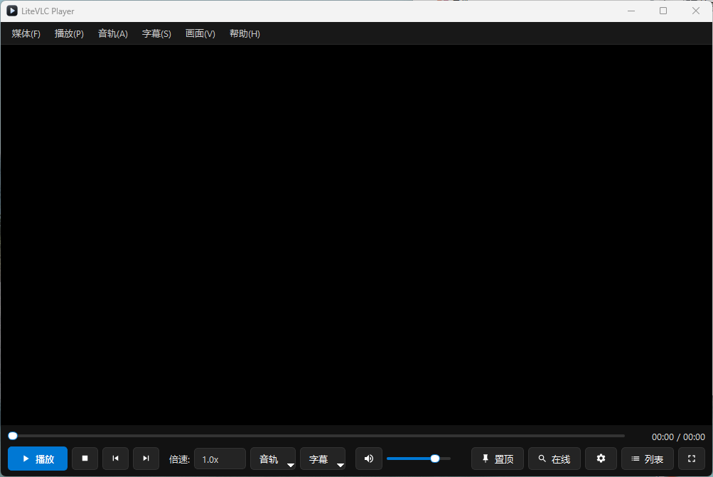
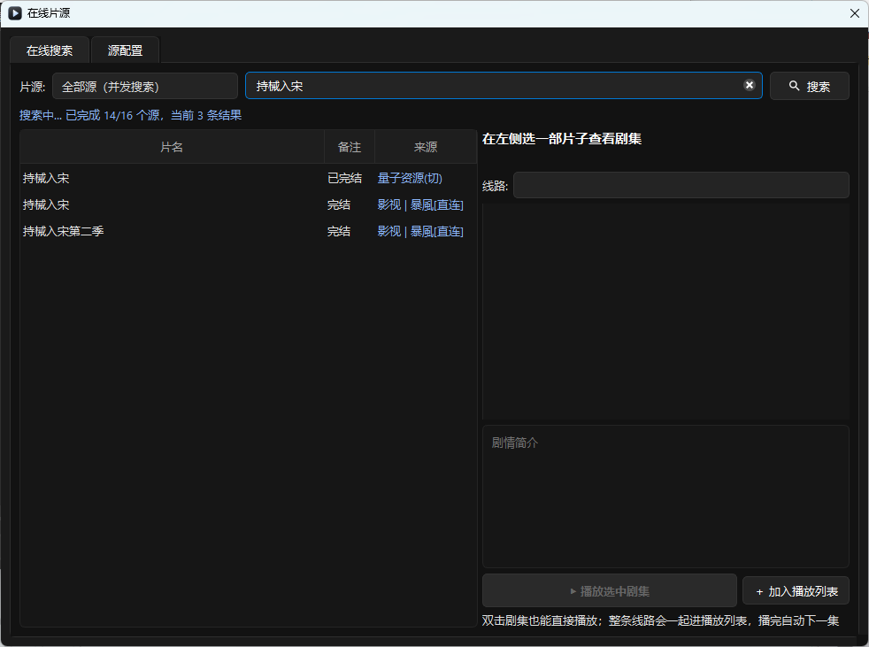

**Eng** | [中文](README.zh-CN.md)

# LiteVLC Player (a minimal Qt 6 QWidget + LibVLC player)

A minimal, high-performance local video player built on **Qt 6 (C++ / QWidget)** and **LibVLC 3.0.21**. All the bloat of upstream VLC — streaming services, media library, skins — is stripped away, leaving only the core day-to-day playback features. It also imports **TVBox-compatible online sources** for search and binge-watching.

<p align="center">
  <br/>
  
</p>

---

## 1. Feature list

### 1.1 Core playback

- **Transport controls** — play / pause / stop, a click-anywhere-to-seek progress bar (`ClickableSlider`), debounced drag seeking, and `Left` / `Right` arrows for ±5 s.
- **Volume and audio tracks** — mouse wheel or `Up` / `Down` for volume, `M` to mute, automatic detection and live switching of multiple audio tracks.
- **Picture and display** — full screen by double-click or `Enter` / `F` (in full screen, moving the pointer to the bottom edge reveals the control bar), aspect ratio locked to the source with presets (`Native` / `16:9` / `4:3` / `21:9` / `1:1`), and flicker-free always-on-top via Win32 `SetWindowPos` (`T`).
- **Loading and resume** — drag a video or subtitle onto the window to play it; playback position is remembered per file (`player_config.json`) and restored with an on-screen OSD hint on the next open.

### 1.2 Advanced

- **External subtitles and timing offset** — automatically scans and loads a sibling `.srt` / `.ass` / `.ssa` file with the same name (language suffixes such as `.zh.srt` are recognised); `[` / `]` nudge the subtitle timeline by ±0.5 s.
- **Playback speed (0.5x – 3.0x)** — via the combo box in the control bar or `C` / `V`, with pitch preserved.
- **Lightweight playlist** — a collapsible `QListWidget` drawer on the right with sequential, list-loop and single-loop modes. Local files and online episodes share one queue.
- **GPU acceleration toggle** — hardware decoding can be switched in Settings (`Auto` / `D3D11VA` / `DXVA2` / software). 4K playback at very low CPU load.
- **Auto-skip intro and outro** — set intro and outro lengths in seconds; binge playback skips the intro and rolls over to the next episode automatically.

### 1.3 Online sources (TVBox subscription compatible)

- **Custom sources** — import a standard TVBox / CatVod subscription JSON (subscription URL, local file, or clipboard). Dispatchers are matched on shape rather than declared type: plain JSON, JSON with `//` comments, whole-body base64, and configs hidden inside a JPEG (image bytes followed by a base64 tail) all import fine. You can also edit `sources.json` in the program directory by hand.
- **Apple CMS interfaces only** — `type=0` (XML) and `type=1` (JSON), with fields aligned one-to-one with TVBox. `jar` / `js` / `py` script spiders need an extra runtime, so they are skipped on import with an explanation in the UI.
- **Concurrent multi-source search** — search one source or all of them at once; results stream in as they arrive, grouped by source and showing title / remarks / source.
- **Episodes and multiple lines** — `vod_play_from` / `vod_play_url` are parsed into play lines plus episode lists; double-click an episode to play.
- **Add to playlist** — "▶ Play selected episodes" appends the whole line to the right-hand playlist and starts it; "＋ Add to playlist" queues without interrupting the current video. Previous / next episode, auto-advance and the three play modes all operate on this single queue.
- **Non-modal search window** — the search window is an ordinary, non-modal window: you can pause, seek and switch episodes while it stays open, and clicking play does not close it, so you can line up several shows in a row.
- **Continuous playback** — episodes advance in playlist order; `PgUp` / `PgDn` for previous / next. If an episode yields an empty stream, or several consecutive episodes fail within a short window, playback stops with a message instead of racing through the season.
- **Hotlink protection** — `User-Agent` / `Referer` are injected per source configuration (Referer defaults to the API's origin), which covers most 403-protected sites.
- **HLS mid-roll ad filtering** — online m3u8 playback is routed through a local relay that splits the manifest on `#EXT-X-DISCONTINUITY` and drops short ad blocks stitched into the middle of the feature; an OSD hint reports "skipped N mid-roll ads". Segments still come straight from the CDN, so no bandwidth is consumed by the relay. Can be disabled in Settings; applies to VOD manifests only — live streams and manifests without ad signatures pass through untouched.
- **Details** — automatic GBK fallback decoding, HTML synopsis clean-up, retry with `ac=detail` when `ac=videolist` returns nothing, and no position memory for network streams.
- **Live TV (TVBox `lives`)** — the same import also picks up live sources (`m3u` / `txt`), so one TVBox address gives you both VOD search and channels. The Live tab pulls the channel lists (grouped, filterable by name); playing a channel queues its whole group, so `PgUp` / `PgDn` zaps between channels. Live entries deliberately bypass the HLS relay: the relay caches manifests, which would freeze a sliding-window live playlist.

### 1.4 Desktop integration and distribution

- **App icon** — program, shortcut and taskbar all use the built-in icon (`resources/app.ico` plus multi-size PNGs, version info embedded in the exe).
- **Manual update check (reserved)** — "Help → Check for updates" only echoes the current version; nothing is checked or downloaded in the background. The update source is GitHub Releases (repository `yc7en/LiteVLC`, injected via `-DAPP_UPDATE_REPO=owner/repo`); no self-hosted server address is built in.
- **Windows 11 installer** — `package.bat` chains compile → windeployqt → copy LibVLC → Inno Setup, producing `dist\installer\LiteVlcPlayer-<version>-Setup.exe` (desktop shortcut, Start menu entry, uninstaller and user-data clean-up included).
- **Adaptive config location** — portable builds (writable program directory) keep config in place; installed under `Program Files` it falls back to `%APPDATA%\LiteVlcPlayer`, so settings and progress still save.

---

## 2. Keyboard shortcuts

| Shortcut | Action |
| :--- | :--- |
| `Space` | Play / pause |
| `Enter` / `F` / double-click | Enter / leave full screen (`Esc` also leaves) |
| `Left` / `Right` | Seek back / forward 5 s |
| `Up` / `Down` / mouse wheel | Volume +5% / −5% |
| `M` | Mute / unmute |
| `[` / `]` | Subtitle timing −0.5 s / +0.5 s |
| `C` / `V` | Playback speed −0.25x / +0.25x (`0.5x` – `3.0x`) |
| `T` | Toggle always-on-top |
| `L` | Show / hide the playlist drawer |
| `Ctrl+F` | Open online source search |
| `PgUp` / `PgDn` | Previous / next episode (online mode) |

---

## 3. Configuring online sources

Sources are decoupled from the player: the player only needs "an http(s) direct link plus UA/Referer". Reliability and legality of a source are entirely up to the subscription you import.

**How to import** (the "Online" button in the control bar, or `Ctrl+F` → "Sources"):

1. **From a subscription URL** — paste a TVBox config address and fetch it.
2. **From a local JSON file** — pick a TVBox config or a `sources.json`.
3. **From the clipboard** — copy a subscription JSON and click once.

**Config file**: `sources.json` in the program directory; a template is generated on first run:

```json
{
    "sites": [
        {
            "key": "demo",
            "name": "Demo source",
            "type": 1,
            "api": "https://example.com/api.php/provide/vod",
            "searchable": 1,
            "timeout": 15,
            "userAgent": "",
            "referer": ""
        }
    ]
}
```

| Field | Meaning |
| :--- | :--- |
| `type` | `0` = Apple CMS XML API, `1` = Apple CMS JSON API |
| `api` | Endpoint, e.g. `https://site/api.php/provide/vod` |
| `searchable` | Include in all-source search, `1` / `0` |
| `enabled` | Enabled (the first column checkbox in the UI maps to this) |
| `userAgent` / `referer` | Empty means built-in browser UA and the API origin as Referer |
| `timeout` | Per-request timeout in seconds, default 15 |

> Only directly requestable Apple CMS endpoints are supported. `jar` / `js` / `py` spiders in the TVBox ecosystem require a JVM / V8 / CPython runtime, which this player does not embed — they are skipped on import.

### When a video will not play

"Found but won't play" is almost always a problem at the URL layer. Every address is pre-checked before playback, and the reason is reported directly:

| Class | Message | Meaning | What to do |
| :--- | :--- | :--- | :--- |
| **A** | Origin server error (HTTP 5xx) | CDN / origin failure, unrelated to parsing | Retry later, or switch line |
| **A** | The response is a nearly empty page | Gateway error page | Switch line / source |
| **B** | Access denied by origin (403) | Hotlink check failed | Set `referer` to the site's home page, or switch line |
| **B** | Playback URL expired (404/410) | Stale link | Switch line / source |
| **C** | No playable address found in the page | Page loads, but the URL is hidden in encrypted script | Switch line |
| **D** | Address computed by page JavaScript at runtime | Needs a browser engine; unsupported in this version | Switch line |
| **E** | Timeout / DNS failure / certificate error | Site down, network blocked, or expired certificate | Switch source; certificate problems are still handed to the engine once |

**Playback automatically tries to resolve play pages**: if a direct link fails and returns a web page, candidates are harvested from it (m3u8 in the body, `player_aaaa`, `<video src>`, one level of `<iframe>`, base64 blobs) and verified one by one; the first that actually yields a stream plays, with the OSD reporting "resolved from play page". At most 8 requests / 15 seconds.

Besides the class, the failure dialog lists status code, Content-Type, content length, page title, and whether iframes or obfuscated JS are present, plus a **"Save response body"** button (writes to `%TEMP%\lvsniff-*.html`). Send that file in and an unparseable site can be diagnosed.

The pre-check itself tries four header combinations (as-is → drop Referer → bare request → media host as Referer) and hands the working one to LibVLC; if the master manifest passes but segments are blocked, playback retries twice with alternate headers after the engine reports an error.

---

## 4. Building and running

The repository ships a trimmed **LibVLC 3.0.21 (win64) SDK and runtime** under `vlc/`, so no environment variables are needed:

> `vlc/` is a ~108 MB third-party binary directory and is **not tracked** (see `.gitignore`). On a fresh clone, populate it first (`sdk/include`, `sdk/lib`, `libvlc.dll`, `libvlccore.dll`, `plugins/`), otherwise CMake cannot find the SDK.

1. Open `CMakeLists.txt` (or `player.pro`) in **Qt Creator**.
2. Pick a **Qt 6 (64-bit, MSVC or MinGW)** kit.
3. CMake copies `libvlc.dll` and `libvlccore.dll` next to the executable after building, and the program locates `vlc/plugins` on startup — just run it.
4. One-command Windows 11 installer: run `package.bat` in the repository root (requires Inno Setup 6; the script looks for `E:\tools\innosetup\ISCC.exe`, then `C:\Program Files (x86)\Inno Setup 6\ISCC.exe`, or honours the `INNO_SETUP` environment variable).

### CI builds for both platforms

One push to `main` (or a manual `workflow_dispatch`) starts two parallel workflows:

- `windows.yml` → `LiteVlcPlayer-<ver>-Setup.exe` and a portable `LiteVlcPlayer-<ver>-win64.zip`
  (MinGW build, `windeployqt`, LibVLC runtime, Inno Setup);
- `macos.yml` → `LiteVlcPlayer-<ver>-arm64.dmg` (see below).

Both read the version from `CMakeLists.txt`, so the two artifacts always carry the same version number. Only commits touching `src/`, `resources/`, `packaging/`, `thirdparty/`, `installer.iss` or `CMakeLists.txt` trigger them — docs-only changes skip CI.

### Publishing a release

Bump the version everywhere it is duplicated (`project(... VERSION)` in `CMakeLists.txt`, `FILEVERSION` in `resources/app.rc`, `MyAppVersion` in `installer.iss`, `APPVER` in `package.bat`), then push a tag:

```bash
git tag v1.1.5
git push origin v1.1.5
```

Both workflows run on the tag and attach their own artifact to the same Release: `LiteVlcPlayer-1.1.5-Setup.exe` (plus a portable zip) from Windows, `LiteVlcPlayer-1.1.5-macos-arm64.dmg` and `LiteVlcPlayer-1.1.5-macos-x64.dmg` from macOS. No manual download-and-upload step. Tag pushes bypass the `paths` filter, so the release always builds. To just verify a build without releasing, push a normal commit or use `workflow_dispatch` — artifacts then stay in Actions for 14 days.

### macOS (Apple Silicon)

arm64 only — **no Mac hardware required**: CI compiles the dmg on GitHub's `macos-15` runners (real Apple Silicon).

1. Push the repository to GitHub; `.github/workflows/macos.yml` runs automatically, or trigger it manually via `workflow_dispatch`.
2. CI pipeline: install Qt 6.8.0 → download and checksum `vlc-3.0.21-arm64.dmg` → CMake (`-DCMAKE_OSX_ARCHITECTURES=arm64`) → `macdeployqt` → `packaging/macos/bundle.sh` embeds VLC, rewrites install names, self-checks the arm64 slice, ad-hoc signs, and produces the dmg → upload artifact.
3. Building locally on a Mac works the same way; just place VLC.app under `vlc/` (or `/Applications/VLC.app`):
   ```bash
   cmake -B build -S . -DCMAKE_BUILD_TYPE=Release -DCMAKE_OSX_ARCHITECTURES=arm64
   cmake --build build
   "$(brew --prefix qt)/bin/macdeployqt" build/LiteVlcPlayer.app -always-overwrite
   packaging/macos/bundle.sh build/LiteVlcPlayer.app vlc/VLC.app/Contents/MacOS 1.1.5
   ```
4. Builds are ad-hoc signed (no Apple Developer certificate), so on first launch use **right-click → Open**, or run `xattr -dr com.apple.quarantine /Applications/LiteVlcPlayer.app`; the dmg includes these instructions.
5. Configuration lives in `~/Library/Application Support/LiteVlcPlayer/` on macOS — never inside the `.app`, which would break the code-signing seal.

> VLC's C headers are vendored (`thirdparty/vlc/include/vlc/`, LGPL-2.1+), so CI does not fetch the source tarball; the macOS `libvlc.dylib` and plugins are extracted from the official arm64 dmg.

---

## 5. Changelog

Convention: **bug fixes** go to `docs/BugFix-YYMMDD-00XX.md`, **feature iterations** to `docs/R-YYMMDD-00XX.md`; each change is a separate git commit whose message names the corresponding document.

| ID | Type | Summary |
|---|---|---|
| `R-261021-0001` | Feature | Online sources: custom sources / search / online playback loop |
| `BugFix-261021-0001` | Fix | Searchable but unplayable: address pre-check, error reporting, header retry |
| `R-261021-0002` | Feature | Play-page sniffing and failure attribution: HTML classes A–E, candidate extraction and re-check, diagnostic dialog with response dump |
| `R-261021-0003` | Feature | Online episodes join the playlist (unified local/online queue) + non-modal search window + advance guard |
| `R-261021-0004` | Feature | App icon + reserved manual update check + one-command Windows 11 installer + AppData config fallback |
| `R-261022-0003` | Improvement | Update source moved to GitHub Releases; self-hosted server address (obfuscation code and history) removed |
| `R-261021-0005` | Feature | HLS mid-roll ad filtering: local relay rewrites the m3u8, drops ad blocks by DISCONTINUITY duration, segments fetched directly |
| `BugFix-261021-0002` | Fix | AES-128 encrypted sources yielded no playable media through the relay: EXT-X-KEY/MAP relative URIs are absolutised, relay returns 302 to the origin on failure |
| `R-261022-0001` | Improvement | Subscription import errors carry statistics (e.g. all N sources are type=3 spiders); mixed configs report how many were skipped |
| `R-261022-0002` | Feature | macOS (Apple Silicon) support: CMake Apple branch, `.app` bundle with Info.plist and icns, platform branches (always-on-top / data dir / hw decode / fonts), GitHub Actions dmg pipeline |
| `R-261022-0004` | Improvement | Bilingual README: English as the primary entry, Chinese moved to `README.zh-CN.md`, `Eng / 中文` switch in both headers |
| `R-261022-0005` | Improvement | Windows joins CI: vendored MinGW import libs, new CMake detection branch, `windows.yml` producing Setup.exe + portable zip alongside the macOS dmg |
| `R-261022-0006` | Improvement | Add app screenshots (main window + online source search) to both READMEs after the intro |
| `R-261022-0007` | Improvement | Tag-triggered releases: pushing `v*` builds both platforms and attaches Setup.exe + dmg to one Release |
| `R-261022-0008` | Feature | Auto subtitles + auto translation (planned): local ASR via sherpa-onnx/SenseVoice with whisper.cpp fallback, llama.cpp MT, self-drawn overlay; audio acquisition split by source type (local pre-transcode / network chunked pre-fetch / live dump) |
| `R-261022-0009` | Feature | Intel Mac support: macOS CI matrix builds x86_64 on `macos-15-intel` alongside arm64; dmg named with the full platform tag (`macos-arm64` / `macos-x64`) so updates can match assets per architecture |
| `R-261022-0010` | Fix | v1.1.4 macOS packaging died in the arch self-check on bash 3.2 runners (`EXPECT_ARCH` read as unset while the log tail was truncated): expected arch is now derived right where it is used, `ERR` trap prints line + command, and CI surfaces the real error line instead of the log tail |
| `R-261026-0001` | Feature | TVBox live sources (`lives`): one import loads `sites` + `lives` together; new Live tab with grouping, name filter and channel zapping via the playlist; live entries bypass the HLS relay (its playlist cache would freeze a sliding-window stream); `effectiveReferer` now keeps custom ports (`authority()` instead of `host()`) |
| `BugFix-261026-0001` | Fix | The `v1.1.5` release shipped without `macos-arm64.dmg`: `hdiutil create` failed intermittently on the arm64 runner while the same commit passed on main minutes earlier. dmg creation now retries 3 times, logs each failure to stderr, and dumps `df -h` if all attempts fail |
| `BugFix-261026-0002` | Fix | Importing a config-distribution URL failed with a bare JSON parse error. Those sites sniff the `User-Agent`: a desktop Chrome UA gets 302'd to the homepage (HTML), only client UAs (`okhttp`, `TVBox`, Android) receive the JSON config. Import now sends a client UA, falls back to a browser UA if the body looks like HTML, and reports the final URL plus the likely causes instead of the raw parser error |
| `BugFix-261026-0003` | Fix | Some subscriptions hide the config inside a JPEG (`Content-Type: image/*`, image bytes followed by a base64 tail) and comment out disabled sites with `//`. `parseConfigJson` now tries four shapes in order — plain JSON, comment-stripped JSON (`//` and `/* */`, string-safe, BOM-tolerant), whole-body base64, and any embedded base64 run ≥256 bytes — each gated by "does it look like a config". TVBox's built-in proxy (`127.0.0.1:*/proxy`) is skipped at import instead of failing forever |
